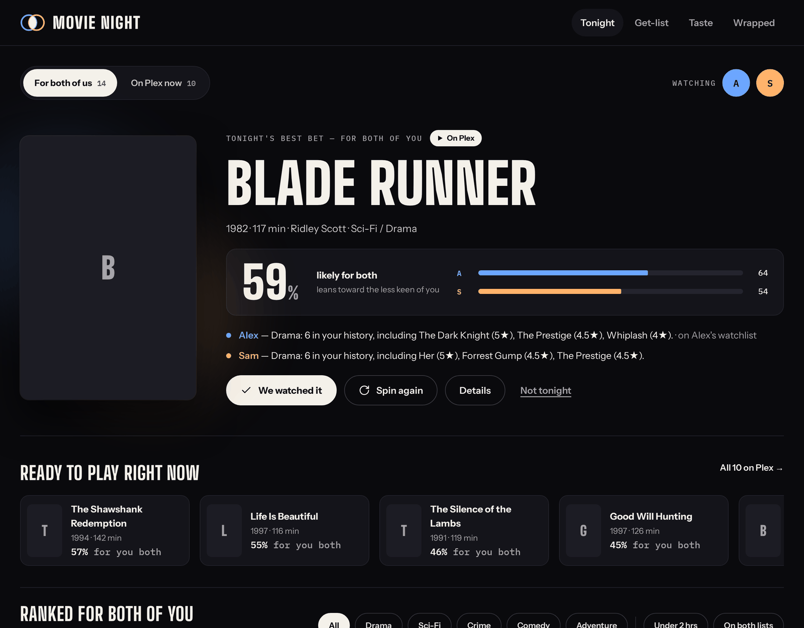
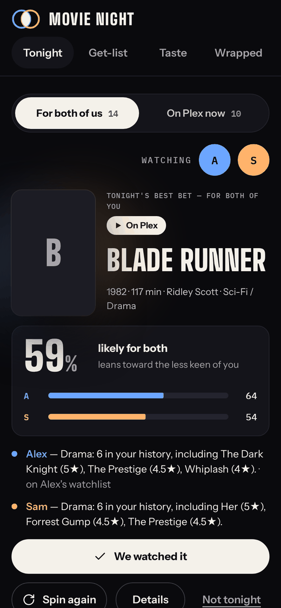
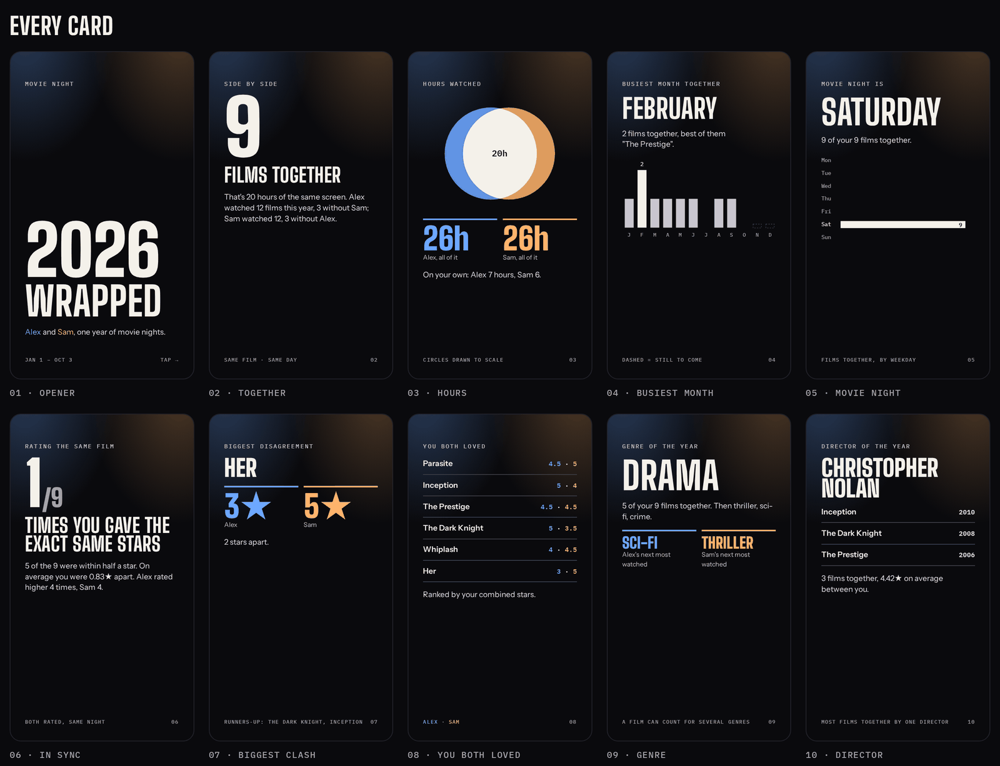
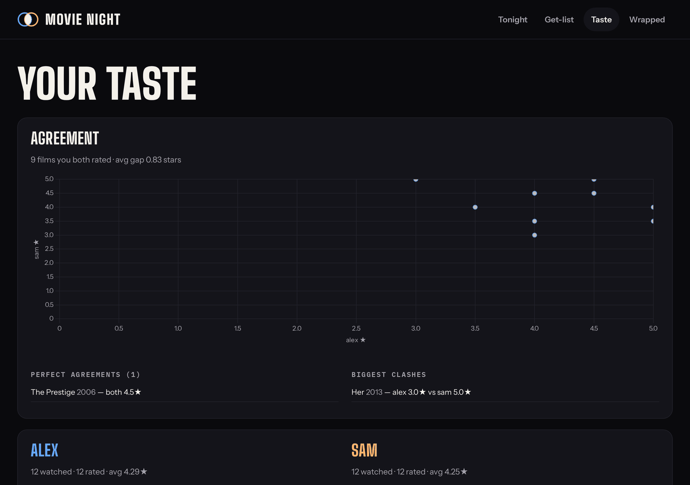

# Movie Night

[](https://github.com/tydude001/movienight/actions/workflows/ci.yml)
[](https://www.python.org/)
[](LICENSE)

What should the two of you watch tonight? Movie Night is a self-hosted web app
for a couple that ranks everything on both your Letterboxd watchlists by **how
likely you *both* are to enjoy it**, narrowed with one tap to what's **actually
on your Plex**. It keeps a get-list of films worth adding (with a feed Radarr can
pull), a dashboard of where your tastes meet, and a **Wrapped** for your year
together — the films you watched as a pair, not just each on your own.

FastAPI + Jinja + HTMX, SQLite, one Docker container, no CDN. Everything stays
on your machine.

<p>
  
  
</p>
<p>
  
</p>
<p>
  
</p>

Every screenshot is the demo couple (`scripts/seed_demo.py`), not anyone's real
viewing history.

[How it works](#how-it-works) · [Quick start](#quick-start) · [Pages](#pages) ·
[Keys](#keys) · [Letterboxd](#letterboxd) · [Privacy](#privacy) ·
[Limitations](#limitations) · [Development](#development)

## How it works

```
Letterboxd export ZIPs ──┐
                         ├──> TMDb id (title + year → id, cached) ──> SQLite
Plex library (GUIDs) ────┘                                              │
                                                                        ▼
                         Tonight (pair-ranked)  +  Get-list  +  Taste  +  Wrapped
```

Every Letterboxd entry is resolved to a **TMDb id** and joined against Plex's
TMDb GUIDs (`app/tmdb.py`, `app/plex_sync.py`, modern and legacy Plex agents).

**Ranking is on the pair score.** Each of you is scored on your own history —
genre and director affinity, films you rated 4★+ counted twice, films you
rated ≤2★ counted against — and the two fits are combined with a harmonic mean:
90 and 30 gives 45, not 60, so a film one of you would merely sit through ranks
low. Being on both watchlists adds 8. Drop one of you for a solo night and the
ranking follows the other's taste alone. It all recomputes per request, so it
tracks your latest import or sync.

## Quick start

You need Docker, a Plex server with a movie library, and a free
[TMDb API key](https://www.themoviedb.org/settings/api).

```bash
git clone https://github.com/tydude001/movienight.git && cd movienight
cp .env.example .env      # then fill it in: Plex, TMDb, your two names, an admin password
docker compose up -d --build
```

Open `http://<host>:8000`. Then:

1. Each of you exports your Letterboxd data (Settings → Data → *Export Your
   Data*) and drops the ZIP in `data/imports/`, named after your user:
   `<USER_A>-anything.zip`, `<USER_B>-anything.zip`.
2. On the **Admin** page, run *Sync Plex*, *Import Letterboxd*, then *Enrich*.

[docs/deploy.md](docs/deploy.md) covers the Plex token, the admin login,
scheduled syncs, backups and putting it behind a proxy.

**Just want to look?** Seed fake data, no Plex or keys needed:

```bash
python -m venv .venv && .venv/bin/pip install -r requirements.txt
.venv/bin/python -m scripts.seed_demo
.venv/bin/uvicorn app.main:app --reload
```

## Pages

- **Tonight** (`/`) — tonight's best bet, then every unseen film either of you
  has watchlisted, ranked by the pair score. *On Plex now* narrows it to what
  can play. Genre chips, *Under 2 hrs*, *On both lists*; *Spin again* draws
  from the top 12; *Not tonight* hides a film until 6 a.m. (`LOCAL_TZ`). When
  nothing fits, it lists each filter to drop and how many films that brings back.
- **Film detail** — tap any poster: each person's own fit with the ratings
  behind it, your shared taste genre by genre, and external scores.
- **Get-list** (`/get`) — films you've marked to add to Plex (they drop off once
  a Plex sync finds them), then the best wanted-but-missing films, by genre.
- **Radarr feed** (`/api/radarr`) — the marked films as a Radarr *Custom Lists*
  import list: `[{"id": <TMDb id>, "title": "…"}]`. Radarr pulls; Movie Night
  never pushes.
- **Taste** (`/dashboard`) — how often you agree, each person's top genres and
  directors, watches over time, shared blind spots.
- **Wrapped** (`/wrapped/{year}`) — your year as story cards for the two of you:
  films and nights together, your hours side by side, the busiest month,
  agreement and the biggest clash, your director and actor of the year, and
  what each of you watched alone. It counts Letterboxd **diary entries** on
  their watch date; `app/wrapped.py` has the three counting rules.
- **Admin** (`/admin`, login required) — run the ingestion jobs and fix films
  that didn't match.

## Keys

| Setting | Needed for | Without it |
|---|---|---|
| `PLEX_BASEURL`, `PLEX_TOKEN`, `PLEX_MOVIE_LIBRARY` | *On Plex now*, the get-list | Everything is "not on Plex". |
| `TMDB_API_KEY` | Matching Letterboxd entries; posters, genres, directors, cast | Plex films still match by GUID, and RSS entries carry their own id; export entries don't resolve. |
| `ADMIN_USER`, `ADMIN_PASSWORD` | The Admin page | `/admin` answers 503 — locked, never open. |
| `OMDB_API_KEY` (optional) | Rotten Tomatoes, IMDb and Metacritic on the detail card | Those three are left off. |
| `NOTIFY_URL` (optional) | An ntfy or Discord ping when a film on both watchlists lands on Plex | No pings. |
| `LETTERBOXD_A`, `LETTERBOXD_B` (optional) | The scheduled RSS sync | Imports only. |

## Letterboxd

Letterboxd has no public API, and its [terms of use](https://letterboxd.com/legal/terms-of-use/)
prohibit automated access. So Movie Night's default path is **your own data
export**, which you're entitled to, and the two readers of letterboxd.com
**ship off**:

- `LETTERBOXD_WATCHLIST_SCRAPE=0` — a weekly job that reads your public
  watchlist pages. Off, your watchlist comes from the export's `watchlist.csv`.
- `LETTERBOXD_SCORES=0` — the Letterboxd average on the detail card, read from
  the film's page.

Turning either on is your call to make, under Letterboxd's terms. The optional
RSS sync (`scripts/sync_letterboxd.py rss`) reads the feed Letterboxd publishes
for your diary, to keep recent watches fresh between exports.

Movie Night is not affiliated with Letterboxd, Plex or TMDb.

## Privacy

Your watch history, ratings and the database stay on your machine. Movie Night
sends film titles and years to TMDb to resolve them, IMDb ids to OMDb if you set
a key, and talks to your own Plex server. Posters load from TMDb's image CDN.

**Reads are open.** Every page, the Radarr feed and Wrapped answer anyone who
can reach the port; only `/admin` needs a login. Run it on your home network,
on a private overlay network, or behind a reverse proxy that adds TLS and
auth — see [SECURITY.md](SECURITY.md).

## Limitations

- **Exactly two people** (`USER_A`, `USER_B`). A solo night works; a third
  person doesn't.
- **Plex only.** Jellyfin and Emby aren't supported.
- **The export is the source of truth.** Re-import a fresh one now and then; it
  overwrites cleanly.

## Development

```bash
python -m venv .venv
.venv/bin/pip install -r requirements.txt -r requirements-dev.txt
.venv/bin/python -m ruff check .
.venv/bin/python -m pytest
```

The suite needs no network and no keys: every test gets a throwaway SQLite
database, and every third party is a mock transport. `CLAUDE.md` describes the
architecture and the decisions behind it; [CONTRIBUTING.md](CONTRIBUTING.md)
says what a pull request is checked against.

```
app/
  config.py      settings from .env
  db.py          SQLite schema + idempotent upserts
  tmdb.py        Letterboxd title/year → TMDb id, cached
  plex_sync.py   Plex library → TMDb ids (modern + legacy GUIDs)
  letterboxd.py  export ZIP → resolve → DB
  enrich.py      genre / director / runtime / poster / cast from TMDb
  taste.py       the taste model: per person, pooled, and pair_fit()
  tonight.py     the Tonight and get-list ranking
  ratings.py     external scores, cached
  dashboard.py   agreement, per person, blind spots, trends
  wrapped.py     the year in story cards, from the diary table
  main.py        FastAPI routes + HTMX fragments
scripts/
  run_ingest.py       CLI ingestion (plex | import-dir | enrich | all)
  seed_demo.py        fake data for clicking around
  sync_letterboxd.py  RSS sync, and the opt-in watchlist scrape
  letterboxd-sync.sh  runs that sync as a one-shot container, for cron
  set-admin-password.sh  change the admin login and check it works
  make-icons.sh       rebuild app/static/icons from favicon.svg
```

This product uses the TMDB API but is not endorsed or certified by TMDB.
